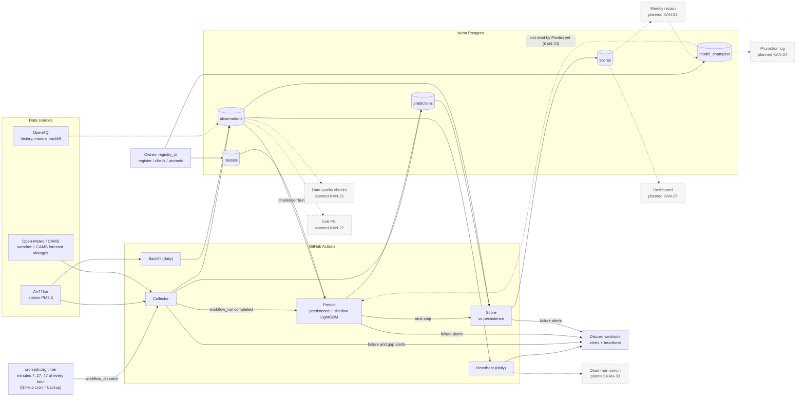

# pm25-forecast

Bangkok PM2.5 24-hour forecast, built as an MLOps portfolio project. The goal is to show an
end-to-end loop running unattended on free tiers: collect data, predict, store, score, monitor,
retrain. The repo is public.

## Architecture

Bangkok PM2.5 forecasting runs unattended on free tiers: an external timer starts the Collector, which
fills Neon Postgres. Predict and Score run after every Collector run, a daily Heartbeat and Backfill
keep it healthy, and failures go to a Discord webhook. Dashed boxes and arrows are planned or not
wired yet.



Notes on the diagram:

- Open-Meteo/CAMS: the Collector stores each CAMS forecast with its issue time (as `cams_global`
  rows in `predictions`). CAMS is no longer a compared baseline: the scored comparison is
  persistence vs the challenger (shadow LightGBM), and CAMS rows are not scored.
- OpenAQ is only used by the manual `OpenAQ Backfill` workflow (and for coverage metrics), so its
  arrow is dashed.
- Predict and Score are two steps of one `Predict` workflow run. Score runs even if Predict failed.
- The `model_champion` pointer exists and can be flipped by hand, but hourly Predict does not read
  it yet. Automatic champion/challenger selection is planned (KAN-23).

## Data flow and schedules

| Workflow | Trigger | Reads | Writes | Normal duration / timeout |
|---|---|---|---|---|
| Collector (`collector.yml`) | cron-job.org calls `workflow_dispatch` at minutes 7, 27, 47 every hour; GitHub cron `7,27,47 * * * *` is a backup | Air4Thai, Open-Meteo (weather + CAMS) | `observations`, CAMS vintages in `predictions`; raw-response artifact (14 days) | 1-2 min per run (workflow comment); timeout 10 min |
| Predict + Score (`predict.yml`) | `workflow_run` after each Collector run completes; backup cron `12 * * * *`; manual | `observations`, CAMS rows, `models` (challenger, if `CHALLENGER_MODEL_VERSION` is set) | `predictions` (`persistence-24h` and challenger, +6/+12/+24 h), then `scores` | Predict "well under 2 min" (workflow comment); timeout 10 min, Score step 4 min |
| Heartbeat (`heartbeat.yml`) | daily 01:17 UTC | `observations` (last 24 h) | One summary line to Discord; alert if DB down or zero rows | Timeout 5 min |
| Backfill (`backfill.yml`) | daily 01:37 UTC; manual (`lookback_days`, default 120) | Air4Thai history (about 3 months kept) | `observations` (idempotent upsert; gap recovery) | 1-3 min (workflow comment); timeout 20 min |
| OpenAQ Backfill (`openaq-backfill.yml`) | manual only | OpenAQ | `observations` | Estimated 5-20 min, not measured ([doc](docs/openaq-backfill.md)); timeout 60 min |
| PM2.5 EDA (`eda.yml`) | manual only | database | EDA report artifact | Timeout 15 min |
| api-probe (`probe.yml`) | manual only | Air4Thai, OpenAQ, Open-Meteo | probe report artifact | Timeout 30 min |
| CI (`ci.yml`) | pull request and push | repo | none | Timeout 10 min |

Why an external timer: GitHub's own cron skipped most scheduled runs (KAN-50, KAN-67), so the
Collector is started by a cron-job.org job calling the GitHub API `workflow_dispatch`. Late or
doubled runs are safe: writes key on data timestamps, and `issue_time` is floored to the UTC hour
so only the first Predict run of an hour writes forecasts (up to 3 runs per hour; later ones only
rescore).

Planned, in progress: data quality checks (KAN-21), drift PSI (KAN-22), weekly retrain (KAN-23),
promotion log (KAN-24), dashboard (KAN-25), dead-man switch (KAN-30).

## Monthly cost

| Service | Plan | Cost / month | Limit that matters |
|---|---|---|---|
| GitHub Actions | Free minutes (public repo) | $0 | Collector runs 3 times an hour, about 2,200 runs/month at 1-2 min each (`collector.yml` notes). Free because the repo is public; a private repo would draw on the plan's minute quota. |
| Neon Postgres | Free tier | $0 | 1 GB storage and 100 CU-hours per project (`docs/storage-decision.md`; the doc marks these figures unverified, re-check on neon.com/pricing). Without retention, predictions would reach 1 GB in about 12-18 months. The decided 90-day purge exists as a statement (`sql.PURGE_OLD_PREDICTIONS`) but no job runs it yet. |
| cron-job.org | Free tier | $0 | Three schedules calling the GitHub API. The repo states no limit. |
| Discord webhook | Free | $0 | Alerts and the daily heartbeat only. |
| Air4Thai | Public API | $0 | Only the latest reading is exposed, hence frequent polling; history window is about 3 months. |
| Open-Meteo | Free tier, CC BY 4.0 | $0 | Non-commercial use only. |
| OpenAQ | Free API | $0 | 60 requests/min and 2,000/hour per key (checked 2026-10-28 in `docs/openaq-backfill.md`). |

**Total: $0 per month.**

What would make it cost money:

- Making the repo private, or Collector frequency growing past the plan's included minutes.
- Exceeding Neon's free storage or compute (purge not running, many more stations, bigger models).
- Commercial use of Open-Meteo (needs a paid plan).
- Needing a higher cron-job.org tier or an OpenAQ quota upgrade (neither is required today).

## Runbook

**Scheduled workflows stopped running.** GitHub disables scheduled workflows after 60 days without
repo activity (noted in `collector.yml` and `heartbeat.yml`). Open the Actions tab, pick the workflow
(Collector, Predict, Heartbeat, Backfill), click "Enable workflow", then "Run workflow" once and
check the log. A commit to the repo counts as activity.

**Renew the cron-job.org token before 2027-01-27.** The timer uses a fine-grained PAT with only
Actions read/write on this repo. Create a new PAT with the same scope, replace it in the cron-job.org
job (all three schedules), trigger a test run, confirm a new Collector run appears in the Actions
tab, then delete the old token. If the token lapses, the GitHub cron backup still fires but skipped
most runs before (KAN-50, KAN-67).

**Alerts** (Discord; the prefix shows the source):

| Alert | Meaning | Action |
|---|---|---|
| `[pm25 collector] gap in Air4Thai data` | Hours missing between stored and newly seen readings | The daily Backfill recovers it from Air4Thai history; check that Backfill ran. |
| `[pm25 collector] stations with no reading for over 3:00:00` | A station is stale (3-4 h); can repeat 1-3 times | Check the Air4Thai site and the run log; usually the source, not us. |
| `crashed`, `run completed with failures`, `configuration error` (collector, predict, score, heartbeat) | A run failed; the message names the step | Open the run link, read the `RUN_SUMMARY` line; fix secrets or variables for configuration errors. |
| `[pm25 ci] failure` or `cancelled`, with a run link | A workflow step failed or hit its timeout | Open the run, read the failing step, re-run once. |
| Database unreachable (run skipped) | Predict, Score or Heartbeat skipped; no stale-data fallback | Check Neon (project, credentials); re-run when it is back. |
| Heartbeat `WARN` or `(STALE)` | Some stations have no reading for over 3 h | As the stale-station alert above. |
| Heartbeat `FAIL` or zero rows in 24 h | The Collector is not landing data | Check the cron-job.org timer, recent Collector runs and the 60-day disable rule. |
| Predict fails after baselines are written | `CHALLENGER_MODEL_VERSION` points at a missing or incompatible model | Run `registry_cli check <version>`; unset the variable to turn the challenger off. |
| No heartbeat arrives at all | Not detected automatically yet | Planned: dead-man switch (KAN-30). Until then, check the Actions tab by hand. |

Diagrams: https://earnrw.atlassian.net/wiki/spaces/EARN/pages/66244/PM2.5+Architecture+Diagrams

## Quickstart

Needs [uv](https://docs.astral.sh/uv/) (it installs Python 3.12 if missing).

```bash
uv sync                  # install dependencies from uv.lock
uv run pytest            # run the tests
uv run ruff check && uv run ruff format --check
cp .env.example .env     # optional: local settings, never commit .env
```

Run a component locally with `uv run python -m pm25_forecast.<module>`, for example `collector`,
`predict`, `score` or `quality`. Each one needs `DATABASE_URL` and the settings in `.env.example`.

Details for each component, its commands and its workflow file are in
[docs/operations.md](docs/operations.md). Architecture and schedules are above.

## Branch and PR rules

- One Jira ticket = one branch (`kan-<n>/<short-name>`) = one pull request.
- The PR description lists the acceptance criteria met.
- Nobody pushes to or merges into `main` except the owner, who reviews and merges.
- Commit messages: `KAN-<n>: <summary>`.
- No secrets and no data dumps in git.

## Time

All timestamps are UTC, in code, storage and logs.

## Data sources and attribution

- Weather and CAMS air-quality forecasts: [Open-Meteo](https://open-meteo.com/), licensed CC BY 4.0 (free tier is non-commercial use).
  Air-quality data contains modified Copernicus Atmosphere Monitoring Service (CAMS) information.
- PM2.5 station observations: Air4Thai, Pollution Control Department (PCD), Thailand.
- Historical backfill and coverage metrics: [OpenAQ](https://openaq.org/).

## Air4Thai TLS (KAN-35)

If Air4Thai fails with `CERTIFICATE_VERIFY_FAILED`, re-run the `api-probe` workflow (Actions tab,
"Run workflow") and read the "Air4Thai TLS diagnosis" section of the job summary or the
`probe-report` artifact. See `certs/README.md` for what to do with the result and
`AIR4THAI_CA_BUNDLE` in `.env.example`.

OpenAQ 730-day history for the five project stations (KAN-49):
`uv run python -m pm25_forecast.openaq_backfill`. See the
[operator guide](docs/openaq-backfill.md) for configuration, restart behavior, source precedence
and post-merge owner actions.
