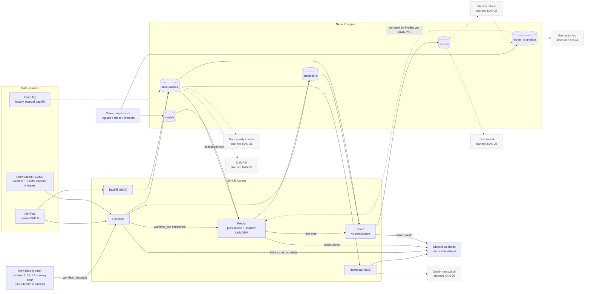

# pm25-forecast

Bangkok PM2.5 24-hour forecast, built as an MLOps portfolio project. The goal is to show an
end-to-end loop running unattended on free tiers: collect data, predict, store, score, monitor,
retrain. The repo is public.

## Architecture

Bangkok PM2.5 forecasting runs unattended on free tiers: an external timer starts the Collector, which
fills Neon Postgres. Predict and Score run after every Collector run, a daily Heartbeat and Backfill
keep it healthy, and failures go to a Discord webhook. Dashed boxes and arrows are planned or not
wired yet.



Notes on the diagram:

- Open-Meteo/CAMS: the Collector stores each CAMS forecast with its issue time (as `cams_global`
  rows in `predictions`). CAMS is no longer a compared baseline: the scored comparison is
  persistence vs the challenger (shadow LightGBM), and CAMS rows are not scored.
- OpenAQ is only used by the manual `OpenAQ Backfill` workflow (and for coverage metrics), so its
  arrow is dashed.
- Predict and Score are two steps of one `Predict` workflow run. Score runs even if Predict failed.
- The `model_champion` pointer exists and can be flipped by hand, but hourly Predict does not read
  it yet. Automatic champion/challenger selection is planned (KAN-23).

## Data flow and schedules

| Workflow | Trigger | Reads | Writes | Normal duration / timeout |
|---|---|---|---|---|
| Collector (`collector.yml`) | cron-job.org calls `workflow_dispatch` at minutes 7, 27, 47 every hour; GitHub cron `7,27,47 * * * *` is a backup | Air4Thai, Open-Meteo (weather + CAMS) | `observations`, CAMS vintages in `predictions`; raw-response artifact (14 days) | 1-2 min per run (workflow comment); timeout 10 min |
| Predict + Score (`predict.yml`) | `workflow_run` after each Collector run completes; backup cron `12 * * * *`; manual | `observations`, CAMS rows, `models` (challenger, if `CHALLENGER_MODEL_VERSION` is set) | `predictions` (`persistence-24h` and challenger, +6/+12/+24 h), then `scores` | Predict "well under 2 min" (workflow comment); timeout 10 min, Score step 4 min |
| Heartbeat (`heartbeat.yml`) | daily 01:17 UTC | `observations` (last 24 h) | One summary line to Discord; alert if DB down or zero rows | Timeout 5 min |
| Backfill (`backfill.yml`) | daily 01:37 UTC; manual (`lookback_days`, default 120) | Air4Thai history (about 3 months kept) | `observations` (idempotent upsert; gap recovery) | 1-3 min (workflow comment); timeout 20 min |
| OpenAQ Backfill (`openaq-backfill.yml`) | manual only | OpenAQ | `observations` | Estimated 5-20 min, not measured ([doc](docs/openaq-backfill.md)); timeout 60 min |
| PM2.5 EDA (`eda.yml`) | manual only | database | EDA report artifact | Timeout 15 min |
| api-probe (`probe.yml`) | manual only | Air4Thai, OpenAQ, Open-Meteo | probe report artifact | Timeout 30 min |
| CI (`ci.yml`) | pull request and push | repo | none | Timeout 10 min |

Why an external timer: GitHub's own cron skipped most scheduled runs (KAN-50, KAN-67), so the
Collector is started by a cron-job.org job calling the GitHub API `workflow_dispatch`. Late or
doubled runs are safe: writes key on data timestamps, and `issue_time` is floored to the UTC hour
so only the first Predict run of an hour writes forecasts (up to 3 runs per hour; later ones only
rescore).

Planned, in progress: data quality checks (KAN-21), drift PSI (KAN-22), weekly retrain (KAN-23),
promotion log (KAN-24), dashboard (KAN-25), dead-man switch (KAN-30).

## Monthly cost

| Service | Plan | Cost / month | Limit that matters |
|---|---|---|---|
| GitHub Actions | Free minutes (public repo) | $0 | Collector runs 3 times an hour, about 2,200 runs/month at 1-2 min each (`collector.yml` notes). Free because the repo is public; a private repo would draw on the plan's minute quota. |
| Neon Postgres | Free tier | $0 | 1 GB storage and 100 CU-hours per project (`docs/storage-decision.md`; the doc marks these figures unverified, re-check on neon.com/pricing). Without retention, predictions would reach 1 GB in about 12-18 months. The decided 90-day purge exists as a statement (`sql.PURGE_OLD_PREDICTIONS`) but no job runs it yet. |
| cron-job.org | Free tier | $0 | Three schedules calling the GitHub API. The repo states no limit. |
| Discord webhook | Free | $0 | Alerts and the daily heartbeat only. |
| Air4Thai | Public API | $0 | Only the latest reading is exposed, hence frequent polling; history window is about 3 months. |
| Open-Meteo | Free tier, CC BY 4.0 | $0 | Non-commercial use only. |
| OpenAQ | Free API | $0 | 60 requests/min and 2,000/hour per key (checked 2026-10-28 in `docs/openaq-backfill.md`). |

**Total: $0 per month.**

What would make it cost money:

- Making the repo private, or Collector frequency growing past the plan's included minutes.
- Exceeding Neon's free storage or compute (purge not running, many more stations, bigger models).
- Commercial use of Open-Meteo (needs a paid plan).
- Needing a higher cron-job.org tier or an OpenAQ quota upgrade (neither is required today).

## Runbook

**Scheduled workflows stopped running.** GitHub disables scheduled workflows after 60 days without
repo activity (noted in `collector.yml` and `heartbeat.yml`). Open the Actions tab, pick the workflow
(Collector, Predict, Heartbeat, Backfill), click "Enable workflow", then "Run workflow" once and
check the log. A commit to the repo counts as activity.

**Renew the cron-job.org token before 2027-01-27.** The timer uses a fine-grained PAT with only
Actions read/write on this repo. Create a new PAT with the same scope, replace it in the cron-job.org
job (all three schedules), trigger a test run, confirm a new Collector run appears in the Actions
tab, then delete the old token. If the token lapses, the GitHub cron backup still fires but skipped
most runs before (KAN-50, KAN-67).

**Alerts** (Discord; the prefix shows the source):

| Alert | Meaning | Action |
|---|---|---|
| `[pm25 collector] gap in Air4Thai data` | Hours missing between stored and newly seen readings | The daily Backfill recovers it from Air4Thai history; check that Backfill ran. |
| `[pm25 collector] stations with no reading for over 3:00:00` | A station is stale (3-4 h); can repeat 1-3 times | Check the Air4Thai site and the run log; usually the source, not us. |
| `crashed`, `run completed with failures`, `configuration error` (collector, predict, score, heartbeat) | A run failed; the message names the step | Open the run link, read the `RUN_SUMMARY` line; fix secrets or variables for configuration errors. |
| `[pm25 ci] failure` or `cancelled`, with a run link | A workflow step failed or hit its timeout | Open the run, read the failing step, re-run once. |
| Database unreachable (run skipped) | Predict, Score or Heartbeat skipped; no stale-data fallback | Check Neon (project, credentials); re-run when it is back. |
| Heartbeat `WARN` or `(STALE)` | Some stations have no reading for over 3 h | As the stale-station alert above. |
| Heartbeat `FAIL` or zero rows in 24 h | The Collector is not landing data | Check the cron-job.org timer, recent Collector runs and the 60-day disable rule. |
| Predict fails after baselines are written | `CHALLENGER_MODEL_VERSION` points at a missing or incompatible model | Run `registry_cli check <version>`; unset the variable to turn the challenger off. |
| No heartbeat arrives at all | Not detected automatically yet | Planned: dead-man switch (KAN-30). Until then, check the Actions tab by hand. |

Diagrams: https://earnrw.atlassian.net/wiki/spaces/EARN/pages/66244/PM2.5+Architecture+Diagrams

## Quickstart

Requires [uv](https://docs.astral.sh/uv/) (Python 3.12 is installed by uv if missing).

```bash
uv sync                 # install runtime + dev dependencies from uv.lock
uv run pytest           # tests
uv run ruff check       # lint
uv run ruff format --check
uv run pre-commit install   # optional: run hooks on every commit
cp .env.example .env        # optional: local settings, never commit .env
```

Collector (KAN-18): `uv run python -m pm25_forecast.collector` needs `DATABASE_URL` and
`STATION_LOCATIONS` (see `.env.example`). The workflow is `.github/workflows/collector.yml` (started by the external timer, see Architecture).

Alerts and heartbeat (KAN-19): everything goes to `ALERT_WEBHOOK_URL` (Discord; the
body carries both `text` and `content`). Without it, alerts are logged only, with a warning.
`python -m pm25_forecast.monitoring.notify failure` is the workflows' `if: failure()` step;
`python -m pm25_forecast.monitoring.heartbeat` posts a daily one-line summary
(`.github/workflows/heartbeat.yml`). Each run logs one `RUN_SUMMARY {json}` line; log timestamps
are UTC.

Backfill (KAN-12 part 1, KAN-34): `uv run python -m pm25_forecast.backfill [--lookback-days 120]
[--stations 59t,61t]` upserts whatever hourly history Air4Thai still holds (a rolling window of
about 3 months) into `observations`. Same settings as the collector; idempotent, so it runs daily
as gap recovery. Workflow: `.github/workflows/backfill.yml`.

Predict (KAN-28): `uv run python -m pm25_forecast.predict` reads stored observations and CAMS rows
and appends `persistence-24h` forecasts (plus a `cams` pass-through of stored CAMS rows, not scored) for +6, +12 and +24 h per station to
`predictions` (idempotent per issue hour). Same settings as the collector; DB down means skip,
alert and exit non-zero. Baselines: `models/baselines.py`. Workflow: `.github/workflows/predict.yml`.

Backtest (KAN-14): `uv run python -m pm25_forecast.backtest /private/path/input.json` runs
read-only rolling-origin evaluation with identical scoring pairs, availability gates, and a
28-day paired CAMS comparison rule. See [input contract and data limitations](docs/backtest.md).
No historical CAMS results are invented when stored vintages are missing.

First local model (KAN-32): on a fresh database, apply `src/pm25_forecast/storage/schema.sql`. On
an existing database, run `src/pm25_forecast/storage/migrations/001_model_manifest.sql` and
`src/pm25_forecast/storage/migrations/002_model_champion.sql` once. Then run this sequence from a
fresh clone:

```sh
uv sync --locked
uv run python -m pm25_forecast.export_history --output data/history.duckdb
uv run python -m pm25_forecast.train_model --export data/history.duckdb --push
```

The export reads observations and stored CAMS forecast vintages in a PostgreSQL read-only
transaction. Training reads only the local DuckDB file. The `--push` step writes the model binary
and manifest to the `models` table, reconnects, reads them back, checks that the artifact digest
and manifest match the submitted values, and deserializes the LightGBM bundle against the shared
ordered feature list. Model versions are immutable: retrying a version with identical content is
idempotent, while different content is rejected. The export and generated artifacts are local,
git-ignored files. `DATABASE_URL` comes from the environment or `.env` and is never included in
logs. The manifest records the UTC training window, held-out metrics, ordered feature list, export
hash, and artifact hash. Registry writes verify that manifest hashes match the exact binary.

Model versions remain immutable. The separate `model_champion` table stores one mutable
`production` pointer to a registered version; moving it never changes a model row. A freshly
trained version is stored without changing the pointer by default. To explicitly register and
promote a model in the same run, add `--promote` to the training command (`--promote` requires
`--push`). `storage.registry.read_champion` returns the pointer plus the content-verified bundle
for a consumer. Hourly prediction does not select this pointer yet; that integration remains in
KAN-29.

Promotions update the single production row. The chosen concurrent-write policy is last successful
upsert wins if PostgreSQL serializes competing writes on that row; there is no compare-and-swap or
model ranking guard. The registry test covers sequential replacement only; it does not verify
concurrent PostgreSQL behavior.

Training uses a strict as-of policy: an observation can be an input only when its exported
`available_at` is no later than the simulated issue time, and a target must be present in the
local snapshot. Hourly issue times are derived from target timestamps and do not require a reading
at the exact issue hour; only earlier readings that passed the availability gate become features.
If any horizon has fewer than 20 eligible examples, training stops with counts for all horizons
and counts of observations and forecast vintages available by their own timestamps. Do not relax
this gate by replacing `available_at` with `ts` or by assuming a historical download was available
when its timestamp occurred. The chronological validation split also requires 20 training rows
per horizon after its horizon-length embargo, so the required sample count can be higher. The live
observations table is upserted and refreshes `ingested_at`; it does not preserve original arrival
times or prior values. The export therefore
supports conservative eligibility checks for the current row, but it cannot reconstruct a fully
faithful historical feature/label snapshot. Collect immutable, timestamped captures over time
before claiming historical training or validation coverage. A current export with less than 24
hours of post-availability observations cannot supply +24h training targets under this policy.

KAN-32 trains and verifies a registered model. `pm25_forecast.predict` emits the KAN-28
persistence baseline every hour (plus a CAMS pass-through that is stored but not scored).

Shadow challenger (KAN-29): set `CHALLENGER_MODEL_VERSION` (a GitHub Actions variable, not a
secret) to a registered model version and the hourly predict step also stores that model's
predictions in `predictions` under its own `model_version`, next to the baselines, for KAN-20 to
score. Nothing uses them for decisions. The model is read once per run from the registry
(content-verified) and loaded by `models.serving`, which accepts both bundle shapes registered as
`format: 1` (KAN-32 multi-horizon `horizons`, KAN-15 single-horizon `horizon_hours` + `booster`)
and requires every booster's feature names to equal the manifest `feature_list` exactly and to be
produced by the shared feature builder. The job builds features as of the floored issue hour, so
live inputs are always at least 1 h old; a manifest declaring `assumed_reporting_lag_hours` below 1
is refused as train/serve skew. This currently refuses the KAN-15 `kan15-retrospective-24h` model
(trained at 0 h lag); it must be retrained at a 1 h lag before it can be the challenger. Challenger
rows are all-or-nothing per run. A missing model, a bad bundle or a feature mismatch fails
the run loudly (alert, exit 1) after the baselines are written. Unset = no challenger.

Owner commands (`DATABASE_URL` from the environment or `.env`, never printed):

```sh
uv run python -m pm25_forecast.registry_cli register --artifact model.json --manifest manifest.json
uv run python -m pm25_forecast.registry_cli check kan15-retrospective-24h
uv run python -m pm25_forecast.registry_cli champion
uv run python -m pm25_forecast.registry_cli promote kan15-retrospective-24h --confirm
```

`register` publishes and reads back without moving the champion. `check` loads a version exactly
as the predict step would. `promote` is the manual champion flip; it needs `--confirm` and refuses
a version the serving loader rejects. The hourly baselines do not read the champion pointer yet;
automatic champion/challenger selection is KAN-23.

Layout: `src/pm25_forecast/{ingest,features,models,storage,monitoring}` and `settings.py`
(environment-driven configuration).

## Branch and PR rules

- One Jira ticket = one branch (`kan-<n>/<short-name>`) = one pull request.
- The PR description lists the acceptance criteria met.
- Nobody pushes to or merges into `main` except the owner, who reviews and merges.
- Commit messages: `KAN-<n>: <summary>`.
- No secrets and no data dumps in git.

## Time

All timestamps are UTC, in code, storage and logs.

## Data sources and attribution

- Weather and CAMS air-quality forecasts: [Open-Meteo](https://open-meteo.com/), licensed CC BY 4.0 (free tier is non-commercial use).
  Air-quality data contains modified Copernicus Atmosphere Monitoring Service (CAMS) information.
- PM2.5 station observations: Air4Thai, Pollution Control Department (PCD), Thailand.
- Historical backfill and coverage metrics: [OpenAQ](https://openaq.org/).

## Air4Thai TLS (KAN-35)

If Air4Thai fails with `CERTIFICATE_VERIFY_FAILED`, re-run the `api-probe` workflow (Actions tab,
"Run workflow") and read the "Air4Thai TLS diagnosis" section of the job summary or the
`probe-report` artifact. See `certs/README.md` for what to do with the result and
`AIR4THAI_CA_BUNDLE` in `.env.example`.

OpenAQ 730-day history for the five project stations (KAN-49):
`uv run python -m pm25_forecast.openaq_backfill`. See the
[operator guide](docs/openaq-backfill.md) for configuration, restart behavior, source precedence
and post-merge owner actions.
