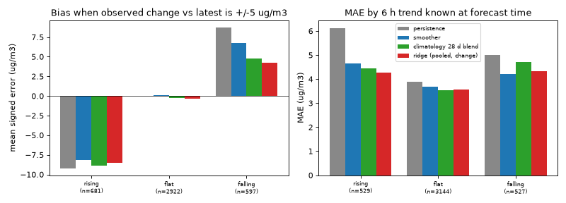
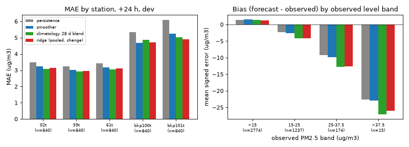
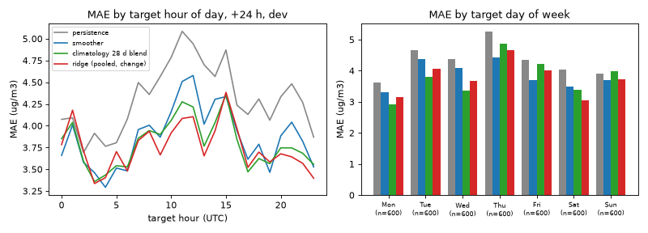
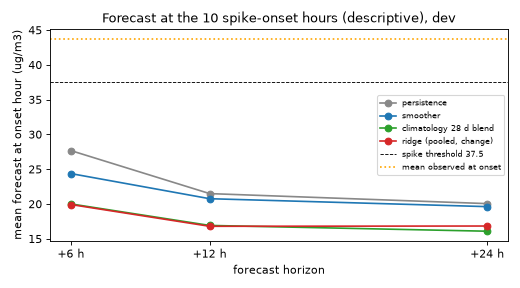

# E16 Error analysis: where the +24 h models fail (KAN-93)

Verdict: **ANALYSIS ONLY, NO MODEL CLAIM.** Descriptively, the error sits in periods where the level moves by more than 5 ug/m3 (a group defined by the outcome, so this is a concentration, not a finding about models), at the two volatile stations, and in the highest levels; no model forecasts any of the 10 spike onsets 24 h ahead. Where the evidence is ex-ante (6 h trend at forecast time) the model differences are small.

Exploratory, dev split only, no preregistration (an analysis, not a model test). The holdout was never read (`--holdout` is not used anywhere). No new MLflow run was logged and no model was trained for this ticket. Group CIs below are unadjusted 72 h moving-block bootstrap intervals over about 25 comparisons: descriptive, not evidence.

## 1. Question and data

Question: for persistence, the smoother and the two best tracked models, which stations, hours, weekdays, level bands and rising or falling periods carry the +24 h error, and can the 10 spike onsets (crossing 37.5 ug/m3) be caught at any lead?

Data: frozen snapshot `e02-v1` (sha256 `a00cfc9e...`), five stations (02t, 59t, 61t, bkp100t, bkp101t), five weekly dev folds, 4,200 +24 h pairs, target days 2026-08-31 to 2026-10-04 (35 days, UTC). `available_at = ts + 1 h`. Models:

- persistence and smoother (the runner's own baselines): MAE 4.311 and 3.867;
- climatology 28 d blend (E05, prereg `e05-clim-28d-blend`): 3.791;
- ridge, pooled, raw target, change-from-latest, `fs_v2_core` (E06, prereg `e06-ridge-pool-raw-chg`): 3.757.

LightGBM `e12-full-l2-delta` (3.868, a tie with the smoother) was not re-run: two models are enough and it adds no new contrast. Predictions were recomputed with the runner's `make_plan`, `select_cohort` and `_walk_forward` (no private scoring loop), with the frozen prereg params. The recomputed overall MAEs equal the tracked values to three decimals (checked: 3.757, 3.791, 3.867, 4.311). The per-pair arrays hold raw readings, so they live outside git (`~/pm25-experiments/cache/kan93/`); the figures and this page carry aggregates only.

Definitions fixed before reading results: bands on the observed level `<15`, `15-25`, `25-37.5`, `>37.5`; "rising", "falling" and "flat" use observed change from the latest reading (actual minus latest) beyond or within +/-5 ug/m3; the same split on a 6 h trend that is known at forecast time (reading at origin-1 h minus origin-7 h) is the ex-ante version. Hours are UTC target hours (Bangkok is UTC+7). Spike onset: an hour above 37.5 whose previous hour is observed and at or below 37.5.

## 2. Findings

### 2.1 Regime changes carry most of the error

Descriptive concentration, not a finding about the models: pairs where the observed change from the latest reading exceeds +/-5 ug/m3 are 30.4% of pairs and carry 58.8% of the smoother's absolute error (53.9% for ridge). This split is defined by the outcome, and any forecast built on the latest reading has a large error when the outcome departs from it, so the share is close to tautological and is shown only to say where the error sits. "Flat" is likewise flat by construction (|change| <= 5), so small errors there, including persistence (2.27, smoother 2.29, climatology 2.37, ridge 2.49), say nothing about skill.

| group | n | pers MAE | smoother MAE | clim MAE | ridge MAE | smoother bias | ridge bias |
|---|---|---|---|---|---|---|---|
| falling | 597 | 8.72 | 6.73 | 4.93 | 4.49 | +6.72 | +4.23 |
| flat | 2922 | 2.27 | 2.29 | 2.37 | 2.49 | +0.11 | -0.35 |
| rising | 681 | 9.20 | 8.13 | 8.89 | 8.55 | -8.12 | -8.54 |

Bias is forecast minus observed. Versus the smoother, ridge differs by -2.24 in falling periods (CI [-2.76, -1.29]), +0.43 in rising ([-0.60, +1.18]) and +0.20 in flat ([-0.02, +0.43]). Because these groups are defined with the outcome, mean reversion alone gives the large opposite biases (+6.7 falling, -8.1 rising for the smoother) for any model that shrinks towards a mean, so these numbers do not show that any model misses information. The ex-ante 6 h trend version, known at forecast time, is much milder and is the only evidence in this section about what a model could use:

| 6 h trend at origin | n | pers MAE | smoother MAE | clim MAE | ridge MAE | smoother bias | ridge bias |
|---|---|---|---|---|---|---|---|
| falling | 527 | 5.00 | 4.22 | 4.70 | 4.34 | -0.71 | -1.73 |
| flat | 3144 | 3.89 | 3.68 | 3.53 | 3.57 | -0.50 | -0.99 |
| rising | 529 | 6.13 | 4.65 | 4.43 | 4.28 | +1.45 | -0.51 |

After a rise in the last 6 h persistence has MAE 6.13 against 4.65 for the smoother and 4.28 for ridge, and after a fall 5.00 against 4.22 and 4.34. The remaining ex-ante differences between smoother, climatology and ridge are 0.1 to 0.4 ug/m3, and the smoother and ridge biases there are +1.45 and -0.51 (rising), so most of the gap to persistence is closed by shrinkage alone. No CIs were computed for the ex-ante groups.

### 2.2 Stations: two stations are the problem

| station | n | pers MAE | smoother MAE | clim MAE | ridge MAE | obs. mean | obs. sd | regime-change share |
|---|---|---|---|---|---|---|---|---|
| 02t | 840 | 3.49 | 3.25 | 3.09 | 3.13 | 13.3 | 4.6 | 23% |
| 59t | 840 | 3.23 | 3.00 | 2.91 | 2.96 | 12.3 | 4.3 | 20% |
| 61t | 840 | 3.42 | 3.19 | 3.05 | 3.10 | 13.5 | 4.5 | 22% |
| bkp100t | 840 | 5.32 | 4.67 | 4.86 | 4.69 | 11.3 | 8.1 | 40% |
| bkp101t | 840 | 6.10 | 5.23 | 5.04 | 4.91 | 16.7 | 6.9 | 47% |

bkp100t and bkp101t have MAE 4.7 to 6.1 against 3.0 to 3.5 elsewhere, an observed sd about 1.6 to 1.8 times larger, and about twice the share of regime-change pairs. They hold 51% of the smoother's absolute error from 40% of the pairs. Persistence versus smoother costs 0.23 at the three calm stations and 0.66 and 0.87 at the two volatile ones, so the best amount of shrinkage differs by station. Ridge beats the smoother only at bkp101t (-0.32, CI [-0.49, -0.17]); at the others its CI includes zero. Why these two stations are more volatile is not known from this data.

### 2.3 Level bands: high levels are under-forecast, low levels over-forecast

Caveat: the first block uses bands of the observed level, i.e. conditioned on the outcome, so under-forecast at high bands and over-forecast at low bands is expected from regression to the mean for every model; read the biases as descriptive. The block after it, by the level known at forecast time, is the ex-ante view.

By observed level, all models over-forecast `<15` (smoother +1.48, ridge +1.25) and increasingly under-forecast above it: 15-25 smoother -2.64 and ridge -4.20; 25-37.5 smoother -9.78 and ridge -12.57; above 37.5 (15 pairs) smoother -22.9 and ridge -26.1. Ridge and climatology shrink harder towards the mean than the smoother: in the 25-37.5 band ridge is worse than the smoother by +2.66 (CI [+0.44, +3.31]), while in `<15` it is better by -0.45 ([-0.77, -0.14]). The 189 pairs above 25 (4.5% of pairs) carry 12.8% of the smoother's error and 16.4% of ridge's.

By the level known at forecast time the picture flips: when the latest reading is 25 to 37.5 (152 pairs) persistence over-forecasts (+7.6), the smoother less (+4.1), and ridge and climatology are near-unbiased (-0.8, -0.4). So shrinkage is right when the level is already high and wrong in the cases that turn into the high values: the high observed levels are mostly not high yet 24 h earlier.

### 2.4 Hour of day and day of week: small, mostly noise

Smoother MAE by target hour ranges 3.29 (04 UTC) to 4.58 (12 UTC); ridge 3.34 (03) to 4.38 (15). Ridge is worse than the smoother around 01 to 02 UTC (4.18 vs 4.01, 3.71 vs 3.58) and better around 09 to 14. Each hour holds 175 pairs and only 35 days, and several hours have a ridge bias near -1 to -2. By weekday the smoother MAE runs 3.31 (Mon) to 4.42 (Thu); With 5 target days per weekday per station, any weekday difference is far more likely to be one or two events than a weekday effect; the worst 10% of days (4 of 35) carry 20% of the smoother's error. Treat hour and weekday patterns as hypotheses at most.

### 2.5 Spike onsets: none caught by any real model

Descriptive only: 10 onsets (15 spike pairs at +24 h, below the protocol minimum of 50, so no recall or precision is defined). Mean observed value at the onset hour is 43.7. Rows are the forecasts issued 6, 12 and 24 h before each onset hour.

| model | caught at +6 h / +12 h / +24 h | alarm hours (any forecast above 37.5), +6/+12/+24 h | false-alarm hours, +6/+12/+24 h | max forecast anywhere at +24 h |
|---|---|---|---|---|
| persistence | 2 / 1 / 0 | 13 / 11 / 9 | 0 / 6 / 7 | 51.4 |
| smoother | 1 / 0 / 0 | 1 / 0 / 0 | 0 / 0 / 0 | 37.0 |
| climatology 28 d blend | 0 / 0 / 0 | 0 / 0 / 0 | 0 / 0 / 0 | 32.8 |
| ridge | 0 / 0 / 0 | 0 / 0 / 0 | 0 / 0 / 0 | 29.9 |

A false-alarm hour is a forecast above 37.5 with no observed exceedance at that station within 12 h. Catch rule: a model catches an onset at lead h if its forecast issued h hours before the onset hour is above 37.5; no_forecast is 0 for every model and horizon, so all denominators are 10. The two persistence +6 h catches (bkp100t, hours 15 and 23 UTC) are not spikes already under way at the onset: the reading used by persistence (7 h before the onset hour) was 45.9 and 50.8, but the station then fell back to 10.3 and 24.9 within 1 to 2 hours and rose again, so these are earlier exceedances that dropped and returned inside one episode. The smoother's single +6 h catch is the hour-23 one. The one persistence +12 h catch (bkp101t, 12 UTC) has a similar pattern (readings of 36.5 and 37.6 about 11 to 12 h before the onset). Persistence's +24 h alarms are a day-old reading carried forward: 7 of 9 are false alarms. The mean forecast at the onset hour is about 16 to 17 (ridge, climatology) and 20 (smoother, persistence) at +24 h, against 43.7 observed, so lowering the alert threshold would not rescue the models: they are far below it. Onsets are short (15 spike hours from 10 onsets). The longest lead at which any model caught an onset is 12 h (one persistence onset); ridge and climatology catch none at any lead.

## 3. Hypotheses (testable, not measured here)

Each needs its own preregistration before a tracked run; effect sizes are unknown.

1. **Station-specific shrinkage.** Basis: persistence-minus-smoother cost is 0.23 at 02t, 59t and 61t but 0.66 and 0.87 at bkp100t and bkp101t (section 2.2). Test: smoother with beta chosen per station on the weeks before each fold (E05 scanned one beta for all stations). Prediction: MAE improves at bkp100t and bkp101t and does not worsen elsewhere; compare with the fixed smoother using the 72 h block CI, per-station gate 10.3 as a secondary check.
2. **Volatility or trend gate.** Basis (ex-ante, section 2.1): by 6 h trend known at forecast time, ridge is best after a rise (MAE 4.28 vs smoother 4.65), the smoother best after a fall (4.22 vs ridge 4.34), and climatology and ridge best when flat (3.53, 3.57 vs 3.68); differences are 0.1 to 0.4 and have no CI, so this may be noise. Test: choose between smoother-like and ridge-like forecasts using only origin-time variables (6 h trend, rolling 6 h sd of the station) and compare with the best single model by the 72 h block CI. Prediction: a small gain at most; also report the share of pairs routed each way.
3. **Neighbour-station upstream features.** Basis: the only ex-ante evidence is weak (after a 6 h rise the smoother still has MAE 4.65 and bias +1.45, section 2.1), and the 10 onsets are missed with a mean forecast of 17 to 20 against 43.7 observed. Whether other stations' readings contain the missing information is unknown; E06 recorded that cross-station features are untested because the runner shows a predictor only its own station. Test: let a model read the other four stations' readings up to the origin (needs a runner change, so a separate ticket) and add lagged neighbour levels and their 6 h changes. Prediction (a guess to be tested): lower MAE after a 6 h rise and at least some of the 10 onsets caught at +6 h; leakage check is that neighbour values at `ts > origin - 1 h` are never visible.
4. **Window target.** Basis: spikes last 1 to 2 h (15 hours, 10 onsets) and no model forecasts above 37.5 at +24 h (smoother maximum 37.0, ridge 29.9). Test: score the same models on the 3 h mean centred on the target hour (or the daily maximum) and see whether skill versus persistence rises; if a window target is acceptable to the product, forecast it directly. Prediction: skill versus persistence is larger for the window than for the single hour. This changes the product question and needs Boss's agreement.
5. **Asymmetric loss for the high tail.** Basis: under-forecast grows from -2.6 (15-25) to -9.8 (25-37.5) for the smoother and further for ridge (-4.2 and -12.6), while pairs above 25 are 4.5% of the data. Test: LightGBM or ridge with a quantile (about 0.7 to 0.8) or weighted loss on the high band, scored on MAE overall and on the 25-37.5 band separately. Prediction: bias in 25-37.5 shrinks towards zero at an overall MAE cost; report that cost. Note the observed-level bias is partly unavoidable mean reversion, so the test must also show it is not just a trade of bias for variance. Only worth running once the holdout or a longer dev has more than 50 spike pairs.

Not tested again: weather and CAMS forecast features (E11 gave no model past the smoother; E10 had no overlap with the dev split).

## 4. Limits

- Dev is 35 target days at five stations in one season (no dry-season high-PM weeks); 15 spike pairs and 10 onsets are descriptive only. Hour and weekday cells hold 175 and 600 pairs from few days, strongly autocorrelated.
- Groups defined by the observed outcome (level band, rising or falling) condition on the target and exaggerate the apparent bias; the ex-ante versions are given next to them.
- About 25 group comparisons were made; CIs are not adjusted for that.
- Only two tracked models plus the baselines were analysed; the LightGBM tie was not re-run.
- The false-alarm rule (12 h window) and the +/-5 ug/m3 band are my choices, fixed before looking, and not protocol values.

## 5. Reproduce

    uv sync --locked --group experiments
    uv run python -m pm25_forecast.experiments.error_analysis collect \
        --snapshot ~/pm25-experiments/snapshots/e02-v1 --out ~/pm25-experiments/cache/kan93
    uv run python -m pm25_forecast.experiments.error_analysis report \
        --cache ~/pm25-experiments/cache/kan93 --figures docs/experiments/figures

No seeds in the models (closed-form ridge, deterministic climatology); the block bootstrap uses the runner's seed 20261101. Code: `src/pm25_forecast/experiments/error_analysis.py`; tests: `tests/test_experiment_error_analysis.py` (synthetic arrays, no network, no snapshot).
